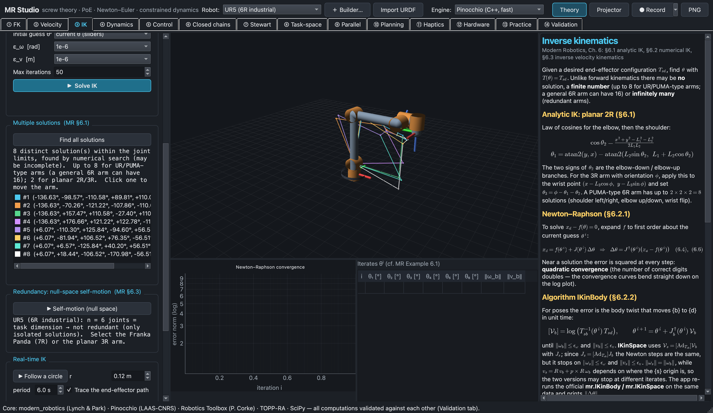
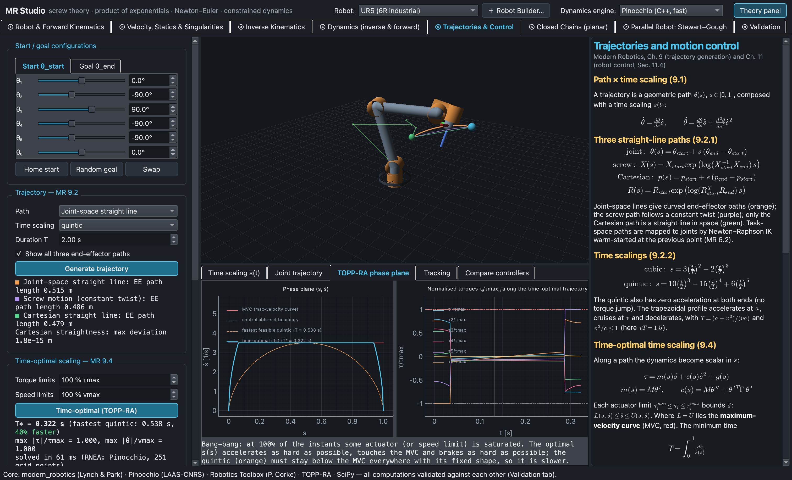
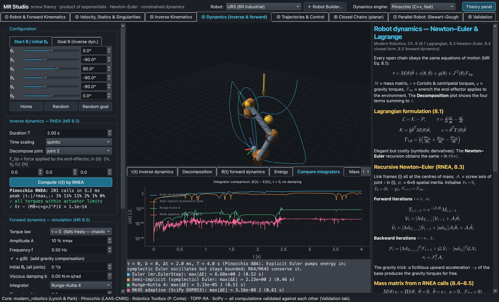
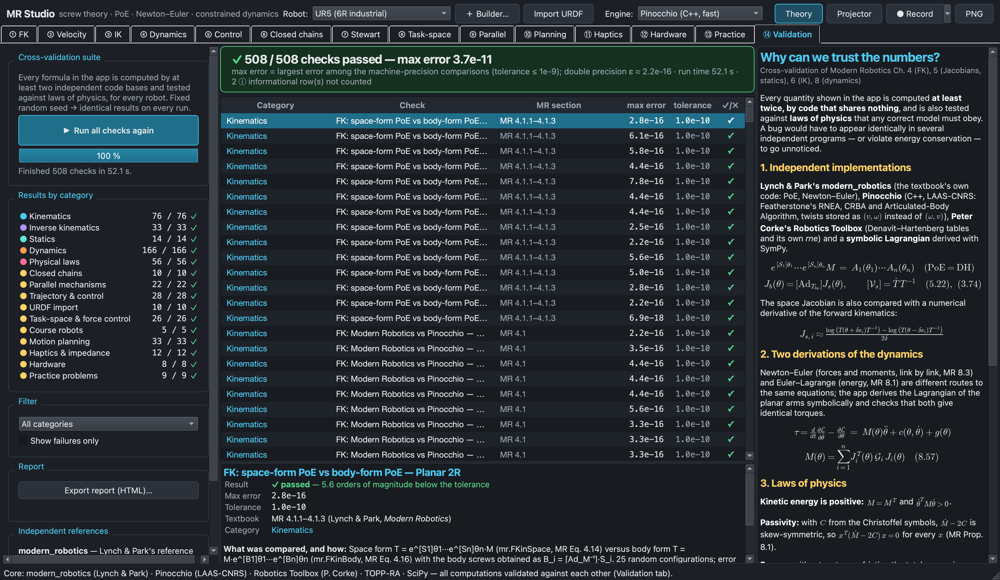

# MR Studio

**Interactive kinematics & dynamics of open and closed robot chains, strictly following
_Modern Robotics: Mechanics, Planning, and Control_ (K. M. Lynch & F. C. Park, Cambridge University Press, 2017).**

MR Studio is a desktop application (Python, PySide6, OpenGL) in which every robot is described the
*Modern Robotics* way: screw axes $\mathcal{S}_i$, the home pose $M$, link frames $M_{i-1,i}$ and
spatial inertias $\mathcal{G}_i$. There are no Denavit–Hartenberg parameters inside. From that one
description the app computes forward and inverse kinematics, Jacobians, statics, singularities,
inverse and forward dynamics, trajectories, time-optimal timing and feedback control. It also
covers task-space, force, hybrid and impedance control, closed chains (four-bar, five-bar) and parallel
robots (Stewart–Gough with dynamics, 3×RPR, Delta), and imports any serial robot from a URDF file. Every tab shows the textbook
section it implements and the equations it uses.

Every number is **cross-validated**. The ⑭ Validation tab re-computes everything with independent
libraries (Lynch & Park's own code, Pinocchio, Peter Corke's Robotics Toolbox, a symbolic
Lagrangian in SymPy) and checks it against laws of physics: 500+ checks in about 30 seconds,
all passing.

| Inverse kinematics: all 8 UR5 solutions | Time-optimal timing (TOPP-RA phase plane) |
|---|---|
|  |  |
| **Integrator energy drift (Euler vs RK4/RK45)** | **Cross-validation suite (all checks pass)** |
|  |  |

More screenshots of each tab are in [`docs/screenshots/`](docs/screenshots/).

---

## Installing MR Studio

**Students (no Python needed).** Download the installer for your computer and open it:

| Computer | File | Steps |
|---|---|---|
| Mac (Apple Silicon, macOS 14 or later) | `MR-Studio-<version>-macOS-arm64.dmg` | Open the `.dmg` and drag **MR Studio** onto **Applications**. The app is not notarised, so the **first launch** needs one extra step: double-click the app and dismiss the warning, then open **System Settings › Privacy & Security**, scroll down and click **Open Anyway** (macOS has removed the right-click › Open shortcut for unnotarised apps). If macOS says the app is **"damaged"**, run `xattr -dr com.apple.quarantine "/Applications/MR Studio.app"` in Terminal, then open it again. |
| Windows 10/11 (64-bit) | `MR-Studio-<version>-Windows-x64-setup.exe` | Double-click it, then **Next**, **Install**. No administrator rights are needed. If SmartScreen appears, click **More info**, then **Run anyway**. |
| Windows, without installing | `MR-Studio-<version>-Windows-x64.zip` | Unzip it and double-click `MRStudio\MRStudio.exe`. |

Each release lists a SHA-256 checksum for every installer in `SHA256SUMS.txt`. To verify a download, compare it with
`shasum -a 256 <file>` (macOS) or `Get-FileHash <file>` (Windows PowerShell). The installers are unsigned, so this is how you
know the file is the one the CI built. Licence: MIT (see [LICENSE](LICENSE)). Third-party components and their licences are
listed in [`THIRD_PARTY_NOTICES.md`](THIRD_PARTY_NOTICES.md).

**Instructors: building the installers.** GitHub can build both installers for you. Push the project to a GitHub
repository. `.github/workflows/build.yml` then runs the tests on Ubuntu and, on pushes to `main`, tags and manual runs, builds the installers on Windows and
macOS and validates the frozen app (`--validate`, `--screenshot`). The installers appear under **Actions** in the run's
*Artifacts*. A `v*` tag (it must equal `VERSION` in `packaging/bundle_config.py`) also publishes them as a Release with
`SHA256SUMS.txt`. To build locally instead:

```bash
./packaging/build_macos.sh                                         # macOS:   packaging/dist/*.dmg
powershell -ExecutionPolicy Bypass -File packaging\build_windows.ps1   # Windows (in a Miniforge Prompt): *-setup.exe and *.zip
```

On Windows, Pinocchio is not on PyPI, so the Windows build uses Miniforge (conda-forge) for it; the script sets this up.

`packaging/README.md` has the details: what is bundled, how to check a built app with `--self-test`, signing, and
the known limitations.

## Install & run (from source)

Tested with Python 3.11 on macOS (Apple Silicon).

```bash
./setup.sh                    # one time: creates .venv and installs requirements.txt
./MR_Studio.command           # start the app (or double-click it in Finder)
# equivalently
.venv/bin/python run_app.py
```

Manual installation:

```bash
python3.11 -m venv .venv
.venv/bin/pip install -r requirements.txt
.venv/bin/python run_app.py
# for the tests: .venv/bin/pip install -r requirements-dev.txt
```

Useful command-line options:

| option | meaning |
|---|---|
| `--robot "PUMA 560 (from Corke DH)"` | robot selected at start-up |
| `--tab 13` | tab opened at start-up (0–13: 0 = ① FK, …, 13 = ⑭ Validation; default: last used) |
| `--projector` / `--no-projector` | start in projector (large-font) mode or not |
| `--screenshot DIR [--only] [--delay ms]` | render every tab (or only `--tab`) to PNG files and exit |
| `--software-gl` | force software OpenGL (see Troubleshooting); same as `MRSTUDIO_SOFTWARE_GL=1` |

Run the validation suite and the tests without the GUI:

```bash
.venv/bin/python -m mrstudio.validation      # prints every check, PASS/FAIL, error and tolerance
.venv/bin/python -m pytest tests -q          # full test-suite (needs requirements-dev.txt) (validation + GUI smoke tests)
```

---

## Features, tab by tab

The **top bar** has the robot selector, the dynamics engine selector and the Theory panel toggle (F1).
The engine selector switches between **Pinocchio** (C++, fast) and **Modern Robotics** (the textbook's
reference Python code); both give identical results. The top bar also opens the **Robot Builder**,
where you define your own robot (revolute **and prismatic** joints) by entering $\omega_i$ (or the slide direction $v_i$), $q_i$ and $M$. Its inertias are
generated automatically, and a robot you build is then validated by the ⑭ Validation suite like the built-in ones.
**File → Import URDF…** (⌘O) loads any serial robot from a URDF file (MR Sec. 8.8) and converts it to screw axes, CoM frames and spatial inertias; 7 example URDFs work offline.

**Presenting:** **Projector** mode (F5 or ⌘⇧P) enlarges all fonts, equations and lines. **● Record** (⌘R) records the 3-D view or the whole window to MP4 or GIF for slides; ⌘⇧S saves a PNG screenshot (⌘⌥S: 3-D view only, with labels). The app remembers the last robot, tab and settings.
**Switching tabs:** ⌘1…⌘9 (Ctrl+1…9) jump to tabs ①–⑨, and Ctrl+Alt+← / Ctrl+Alt+→ (⌥⌘← / ⌥⌘→ on a Mac) go to the previous / next tab, which reaches ⑩–⑭.

| Tab | What you can do | *Modern Robotics* |
|---|---|---|
| **① FK** | Joint sliders, animation. Space and body screw-axis tables. $T(\theta)$ by the product of exponentials (space and body form agree). The Chasles screw of $T M^{-1}$ drawn as a line. Link centre-of-mass frames, end-effector trace. | Ch. 3, 4 |
| **② Velocity** | Joint rates → spatial twist ($\dot p$, $\omega_s$ drawn). End-effector wrench → joint torques $\tau = J^T\mathcal{F}$. Velocity and force manipulability ellipsoids with $\mu_1, \mu_2, \mu_3$. "Find nearest singularity". Monte-Carlo workspace coloured by manipulability. | Ch. 5 |
| **③ IK** | Newton–Raphson (body or space frame) with every iterate drawn as a ghost (cf. Example 6.1). Damped least squares. "Find all solutions" (e.g. the UR5's IK branches). Analytic planar IK. Null-space self-motion of the redundant Panda. Real-time IK following a circle. | Ch. 6 |
| **④ Dynamics** | RNEA joint torques along a quintic/cubic/trapezoidal trajectory, with optional gravity compensation and a tip force. Forward-dynamics simulation with playback. Integrator comparison (energy drift of explicit Euler vs higher-order methods). | Ch. 8 |
| **⑤ Control** | Joint, screw and Cartesian paths with cubic, quintic and trapezoidal time scaling. **Time-optimal** timing with TOPP-RA under torque and velocity limits. Feedback control (PD, PID, PD + gravity compensation, **computed torque**) with optional actuator saturation, and a controller comparison. | Ch. 9, 11 |
| **⑥ Closed chains** | Four-bar linkage (1 DOF) and five-bar parallel robot (2 DOF), modelled as a tree of serial branches plus one cut joint. Constraint Jacobian $A(\theta)$, assembly modes (flip σ), coupler curves, Type I / Type II singularity loci. Inverse dynamics with Lagrange multipliers (the constraint forces), and a live free-swing simulation with optional Baumgarte stabilisation. | Ch. 7, Sec. 8.7 |
| **⑦ Stewart–Gough** | 6-leg parallel robot with two input modes: pose → leg lengths (closed-form inverse kinematics) and leg lengths → pose (Newton–Raphson forward kinematics). Shows all the forward-kinematics solutions found (assembly modes) as ghost platforms. Payload statics $\mathcal{F}_s = J^T f$ (leg forces) and a singularity indicator. "▶ Dance" animation. **Dynamics** (massless legs, platform + payload as one rigid body, Eqs. 8.40, 8.42): dynamic vs static leg forces along the dance, power balance, and a "push" simulation with or without a leg servo. | Secs. 7.1.2, 7.2.1, 7.3, 8.2.2 |
| **⑧ Task-space** | Velocity-input task-space control (Eq. 11.16/11.18); task-space computed torque with $\Lambda, \eta$ (Eqs. 11.47, 8.89–8.91); force control against a stiff surface (11.54); hybrid motion–force "wiping" with the projection $P(\theta)$ (11.60–11.61); impedance control with/without a wrist force sensor (11.64–11.66). Redundant arms and singularities handled with damped least squares. | Ch. 11, Sec. 8.6 |
| **⑨ Parallel** | 3×RPR planar parallel robot: closed-form IK, all (up to 6) forward-kinematics solutions as ghosts, workspace and actuator-singularity locus. Delta robot: closed-form IK and FK (trilateration), Jacobian, motor holding torques, workspace, pick-and-place animation. | Secs. 7.1.1, 7.2, 7.3; Ex. 2.7 |
| **⑩ Planning** | Motion planning for the planar 2R / 3R arms: configuration-space obstacles, grid search (Dijkstra, A*), sampling planners (PRM, RRT, RRT*), shortcut smoothing, and time scaling of the planned path. | Ch. 10, 9 |
| **⑪ Haptics** | A Hapkit-type 1-DOF haptic paddle rendering sampled-data virtual walls and springs (impedance and admittance rendering) with a user-hand model, passivity / stability indicators and the energy-leak plot. | Sec. 11.7 |
| **⑫ Hardware** | Hardware bridge for the course arm (or its simulation): streams a joint trajectory at 50 Hz, logs commanded vs measured joints in the SBEG 361 / 461 CSV formats, enforces the safety checklist and computes the hardware acceptance tests HW-2 … HW-6. See *Hardware bridge* below. | — |
| **⑬ Practice** | Randomised exercises with worked solutions and quiz export. | Ch. 3–11 |
| **⑭ Validation** | One-click cross-validation of everything above (500+ checks), with a colour-coded table, a details pane per check, a theory panel and an HTML report export. | Ch. 4–9, 11 |

### Hardware bridge (tab ⑫)

The tab drives the course arm (myCobot-280 class) over a serial port, or a built-in simulation of it.

* Put the arm in **Transponder mode** (the arm's controller then forwards the serial commands to the servos).
* Choose the port: on a Mac it is `/dev/cu.usbserial-*`; on Windows a `COM` port. The baud rate is **115200** (default) or **1000000**, whichever the arm's firmware uses.
* **Calibration is required before Run.** Until the servo zero offsets are calibrated, the PoE zero pose does not match the servos' zero (the tab shows a warning), so calibrate first.
* **First-run protocol:** low speed first; move one joint only, by at most **±10°**; keep **a person at the power switch**; do a **cable-pull test** (unplug the USB cable while moving: the arm must stop safely); release the torque **last**, with the arm supported by hand or on its rest.
* The installed app bundles pyserial but cannot install the myCobot SDK later; build the app with `pymycobot` installed if you need that back-end.

### Robots

| Robot | Source |
|---|---|
| Planar 2R arm, Planar 3R arm | Uniform-rod links in a vertical plane (gravity −y), MR Ch. 4 & 8 style |
| UR5 (6R industrial) | Screw axes of MR Example 4.5 and the inertial data of the MR Course 3 UR5 assignment |
| PUMA 560 | Corke's `rtb.models.DH.Puma560` (standard DH), **converted automatically to screw axes + spatial inertias** |
| Franka Panda (7R, redundant) | Corke's `rtb.models.DH.Panda` (modified DH), converted the same way |
| KUKA iiwa 7 (7R, redundant) | Imported from its **URDF** (bundled, MIT licence) with full inertial data; torque limits from the KUKA datasheet |
| Stanford arm (RRPRRR) | Corke's `rtb.models.DH.Stanford` (prismatic joint 3); inertias generated automatically |
| SCARA Cobra 600 (RRPR) | Corke's `rtb.models.DH.Cobra600` (prismatic quill); inertias generated automatically |

---

## Troubleshooting

* **Black or empty 3-D view, or the app crashes on start (virtual machines, remote desktop, old GPU drivers).** Start with
  `--software-gl`, or set `MRSTUDIO_SOFTWARE_GL=1` (Mesa software OpenGL; slower but works everywhere).
* **Where are the logs?** macOS: `~/Library/Logs/MR Studio/mrstudio.log`. Windows: `%LOCALAPPDATA%\MR Studio\mrstudio.log`.
  A crash of the installed app leaves a Python traceback there. Please attach it to bug reports.
* **macOS says the app is damaged or from an unidentified developer:** see *Installing MR Studio* above.
* **Settings** (last robot, tab, projector mode) can be redirected with the `MRSTUDIO_SETTINGS` environment variable (path of an `.ini` file).

---

## Libraries used — "don't reinvent the wheel"

| Library | Used for | Why |
|---|---|---|
| [`modern_robotics`](https://github.com/NxRLab/ModernRobotics) | Every textbook formula: `FKinSpace/Body`, `JacobianSpace/Body`, `IKinBody/Space`, `MatrixExp6/Log6`, `Adjoint`, `InverseDynamics`, `MassMatrix`, `ForwardDynamics`, time scalings, `ComputedTorque`, … | It is the authors' own reference code, so the app does exactly what the book says |
| [Pinocchio](https://github.com/stack-of-tasks/pinocchio) (LAAS-CNRS) | Fast dynamics: RNEA, CRBA, ABA, Coriolis matrix, frame Jacobians | C++ implementation of Featherstone's algorithms. Fast enough for real-time simulation. Its models are **generated from the same PoE data** (`dynamics.to_pinocchio`) |
| [Robotics Toolbox for Python](https://github.com/petercorke/robotics-toolbox-python) (P. Corke) | DH models of the PUMA 560 and Panda; an independent reference (`fkine`, `jacob0`, `rne`) | Well-known, independently written DH-based code |
| [TOPP-RA](https://github.com/hungpham2511/toppra) | Time-optimal path parameterisation | Reachability-analysis algorithm (Pham & Pham, 2018) |
| SciPy | Adaptive ODE integration (DOP853), root finding | Standard numerical tools |
| SymPy | Symbolic Euler–Lagrange derivation (validation) | A derivation that shares no code with Newton–Euler |
| PySide6, pyqtgraph, PyOpenGL, matplotlib | GUI, 3-D view, plots, rendering of the theory-panel equations | — |

Conventions follow the book: twists $\mathcal{V} = (\omega, v)$, wrenches $\mathcal{F} = (m, f)$,
screw axes in {s} unless stated, radians internally and degrees on screen.

---

## How correctness is validated

`mrstudio/validation.py` (⑭ Validation tab, `python -m mrstudio.validation`, and `pytest`) runs
500+ quantitative checks. All of them use a **fixed random seed**, so every run gives the same
numbers. Each row reports the largest discrepancy found and the tolerance it must stay under.

1. **Independent implementations must agree to machine precision** (typically 1e-16 – 1e-13):
   * FK: space-form vs body-form PoE; Modern Robotics vs Pinocchio; Corke's DH `fkine` vs the
     automatically converted PoE model (PUMA 560, Panda, UR5).
   * Jacobians: $J_b = [\mathrm{Ad}_{T_{bs}}] J_s$; MR vs Pinocchio LOCAL/WORLD Jacobians
     (Pinocchio orders twists as $(v, \omega)$, and the conversion is explicit); Corke's `jacob0`.
   * Dynamics: `mr.InverseDynamics` vs Pinocchio RNEA vs Corke's `rne` on the original DH models;
     `mr.MassMatrix` vs Pinocchio CRBA vs $\sum_i J_i^T \mathcal{G}_i J_i$;
     `mr.ForwardDynamics` vs Pinocchio's articulated-body algorithm;
     $C(\theta,\dot\theta)\dot\theta$ vs `mr.VelQuadraticForces`.
   * **Newton–Euler = Lagrange**: the equations of motion of the planar arms are derived
     symbolically with SymPy from the robots' own masses and inertias and compared with RNEA
     (MR 8.1 vs 8.3).
   * IK: Newton–Raphson vs `mr.IKinBody`; analytic vs numerical planar IK; FK(IK(T)) = T.
2. **Laws of physics / mathematics must hold:**
   * $J_s$ equals the finite-difference derivative of FK (via $\log(T(\theta+\delta e_i)T^{-1})$).
   * $M(\theta)$ is symmetric positive definite.
   * $\dot M - 2C$ is skew-symmetric (passivity, MR Prop. 8.1). As a contrast, a naive factorisation
     with the same $C\dot\theta$ is shown to fail it.
   * Statics: $\tau = J_s^T \mathcal{F}_s$ equals RNEA at rest (`mr.EndEffectorForces`, Pinocchio external forces).
   * Energy is conserved in free motion (adaptive RK45, relative drift about 1e-10). The drift of
     explicit Euler is reported for contrast.
   * Power balance $dE/dt = \tau^T\dot\theta - \dot\theta^T B\dot\theta$ with motors and friction.
3. **Module checks** collected from `closed_chains`, `parallel`, `trajectory` and `control` (each
   module exposes `validation_checks()`). Examples: loop-closure residuals, constrained-dynamics
   power balance, Stewart IK/FK round trips, time-scaling boundary conditions, TOPP-RA limit
   satisfaction, computed-torque error dynamics.
4. **Negative controls** (`tests/test_validation.py`) show that the checks can actually fail. A
   1 % error in one link inertia, a Jacobian scaled by 1.0001, or a small unmodelled force is
   detected.

Tolerances reflect what double precision allows ($\epsilon \approx 2.2\times10^{-16}$):
* about 1e-10 for direct comparisons;
* about 1e-7 for finite differences and IK. `mr.MatrixLog3` obtains the rotation angle from
  $\arccos((\mathrm{tr}R-1)/2)$, which cannot resolve rotations below about 1.5e-8 rad.
* 1e-6 relative for the energy and power checks.

The tab's **Export report (HTML)** button writes a stand-alone report with every check, its explanation and the library versions.

---

## Project structure

```
run_app.py                 entry point (also: --screenshot / --tab / --robot)
setup.sh, MR_Studio.command, requirements.txt, requirements-dev.txt, pyproject.toml
CITATION.cff, THIRD_PARTY_NOTICES.md
packaging/                 PyInstaller spec, build scripts, Inno Setup script -> .dmg / setup.exe (see packaging/README.md)
.github/workflows/build.yml  CI: tests (Ubuntu) + installers and frozen-app validation (Windows, macOS)
mrstudio/
  robots.py                SerialRobot (M, Slist, Mlist, Glist …), the robot library, DH→PoE conversion, Robot Builder helpers
  kinematics.py            FK, Jacobians, manipulability, singularities, statics, IK (Ch. 4–6)
  dynamics.py              DynamicsEngine (Pinocchio / MR back-ends), simulate(), to_pinocchio() (Ch. 8)
  trajectory.py            time scalings, joint/screw/Cartesian paths, TOPP-RA (Ch. 9)
  control.py               PID, PD + gravity, computed torque, payload models (Ch. 11)
  closed_chains.py         four-bar, five-bar: loop closure, constrained dynamics (Ch. 7, 8.7)
  parallel.py              Stewart–Gough platform (Ch. 7)
  checks.py                Check record used by every validation_checks()
  validation.py            cross-validation suite + HTML report
  gui/
    app.py                 main window, tab list, screenshot mode
    base.py                AppContext (selected robot, engine) and BaseTab layout
    viewer.py              OpenGL scene (robots, frames, screws, ellipsoids)
    widgets.py, theme.py   sliders, matrix views, plots, dark theme
    theory.py              theory panel (LaTeX rendered with matplotlib mathtext)
    robot_builder.py       Robot Builder dialog
    tabs/                  one module per tab: fk, velocity, ik, dynamics, control, closed (closed chains),
                           stewart, advanced_control (task-space), parallel, planning, haptics, hardware,
                           practice, validation
tests/
  test_validation.py       the whole suite must pass, plus negative controls
  test_gui_smoke.py        every tab imports, theory equations render, Validation tab works headless
```

See `DEMO_GUIDE.md` for a 10-minute demonstration script, and `DEVELOPER.md` for coding conventions.
